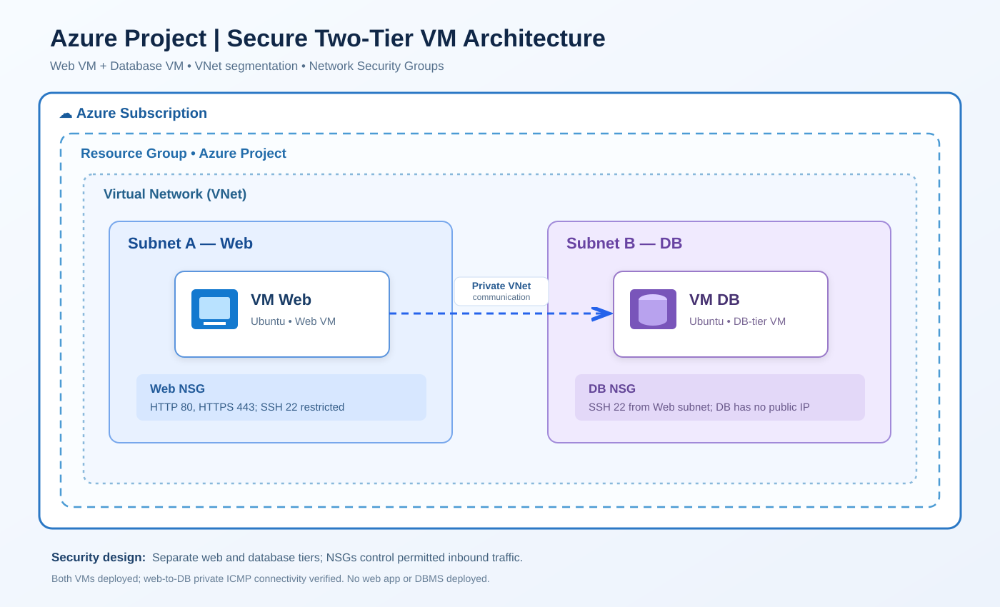
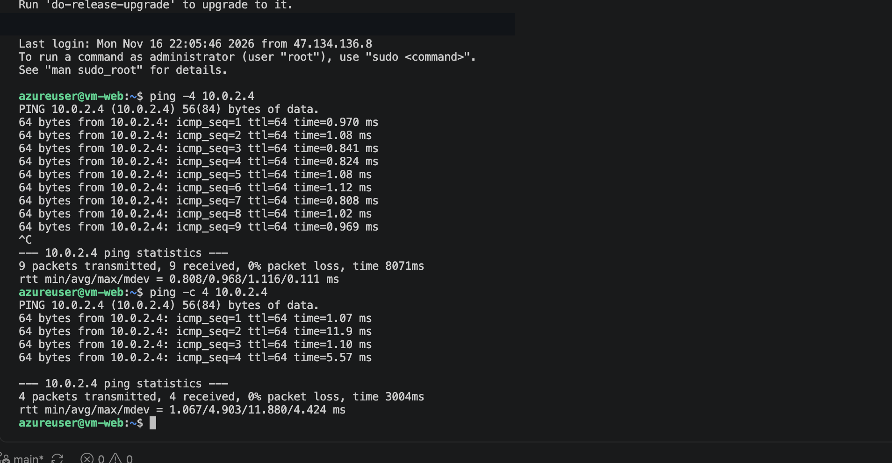
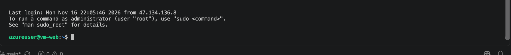
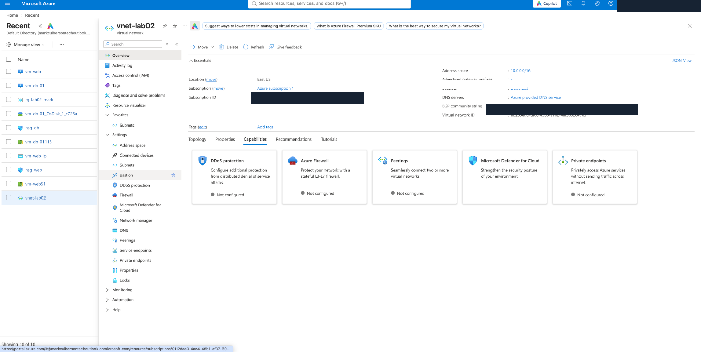
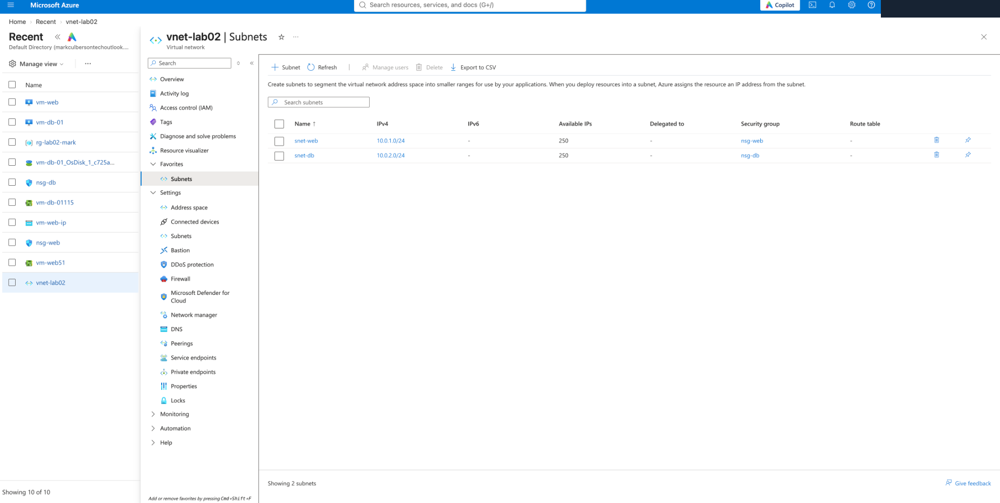
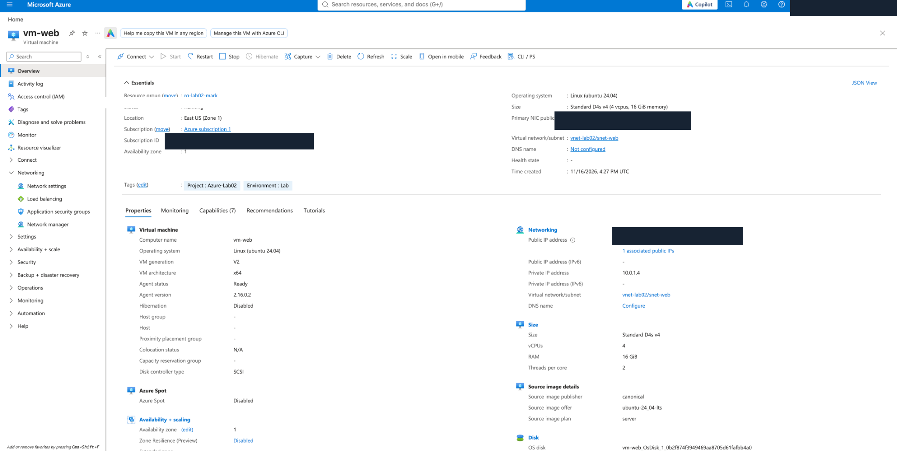
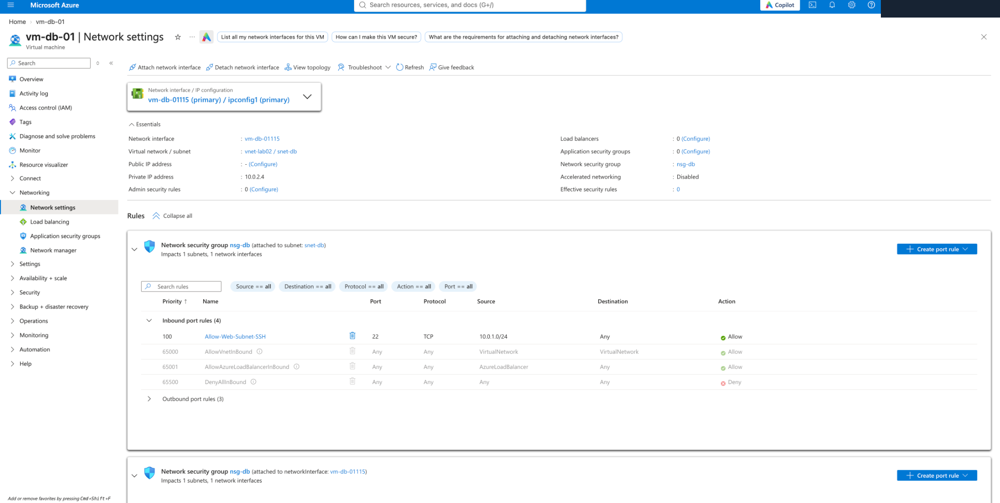
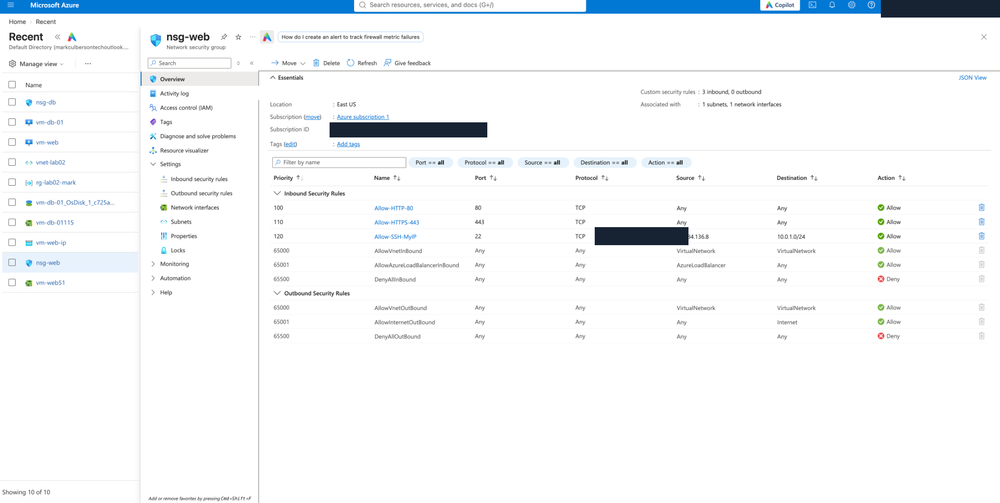
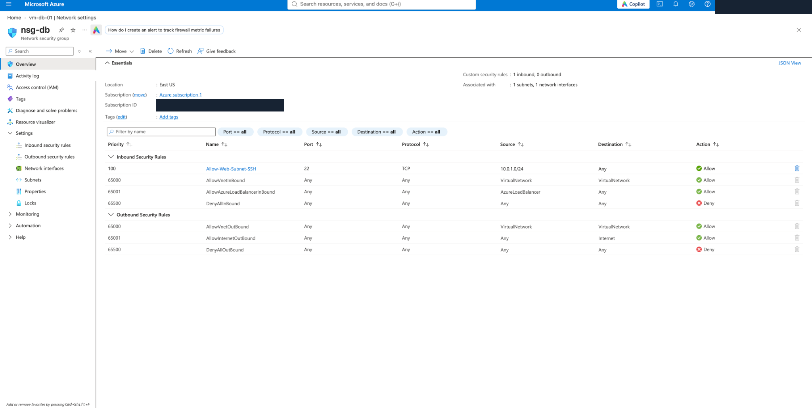

# Azure Secure Two-Tier Network Architecture

**Microsoft Azure · Virtual Networking · Linux · Network Security Groups · SSH · IaaS**

## Project overview

Built an Azure infrastructure-as-a-service (IaaS) lab with separate web and database virtual machines in two subnets of one virtual network. The web VM has a public IP for administration; the database VM has **no public IP**. Configured network security groups (NSGs) and validated that the web VM can reach the database VM over Azure's private network.

> **Scope:** This is an infrastructure/network segmentation lab, not a deployed website or database application. The database VM represents a future database tier; no DBMS installation or database transactions are claimed.

## Architecture



*Architecture diagram: separate web and database-tier Ubuntu VMs, subnet-associated NSGs, and tested private connectivity. This lab did not deploy a web application or database engine.*

## Infrastructure inventory

| Resource | Configuration |
|---|---|
| Resource group | `rg-lab02-mark` |
| Region | East US |
| VNet | `vnet-lab02`, `10.0.0.0/16` |
| Web subnet | `snet-web`, `10.0.1.0/24` |
| Database subnet | `snet-db`, `10.0.2.0/24` |
| Web VM | `vm-web`, Ubuntu Server 24.04 LTS, `Standard_D4s_v4`, private IP `10.0.1.4` |
| Database VM | `vm-db-01`, Ubuntu Server 24.04 LTS, `Standard_D4s_v4`, private IP `10.0.2.4`, **no public IP** |
| Web NSG | `nsg-web`, associated with web subnet |
| Database NSG | `nsg-db`, associated with DB subnet and DB NIC |
| SSH authentication | Azure VM key pair `key-lab02`; private key retained on local Mac |

**Privacy note:** The public IP is intentionally omitted from this portfolio document. Live IPs, subscription IDs, SSH private keys, and other credentials should not be committed.

## Security controls configured

**Web tier (`nsg-web`):** HTTP/TCP 80 allowed (priority 100); HTTPS/TCP 443 allowed (priority 110); SSH/TCP 22 allowed from the administrator's specified public IP (priority 120). These are documented configured rules, not proof that web services are running.

**Database tier (`nsg-db`):** Custom inbound allow for TCP/22 from web subnet `10.0.1.0/24` (priority 100). The database VM has no public IP, reducing direct internet exposure.

### Important limitation: segmentation not fully verified

Azure NSGs include a default **AllowVnetInBound** rule (priority 65000), which can permit traffic from other addresses within the VNet unless an earlier explicit deny rule blocks it. The current DB custom rule also allows **any machine in the web subnet** to access SSH, not only the specific web VM. Therefore, **do not interpret this lab as proof that only the web VM can reach the DB VM**. A production design should restrict to the required application/database ports and sources, explicitly deny unwanted east-west traffic, and test both permitted and denied paths. No DBMS or database port was configured for this exercise.

## Connectivity validation

From the administrator's Mac, authenticated SSH to `vm-web` using the local `.pem` private key. From `vm-web`, tested private IP reachability:

```bash
ping -c 4 10.0.2.4
```

**Observed result:** 4 packets transmitted, 4 received, **0% packet loss**; average round-trip time approximately **4.903 ms** in the captured test. A separate TCP connection test to `10.0.2.4:22` returned `SSH PORT OPEN` during the lab.

```bash
timeout 5 bash -c 'echo > /dev/tcp/10.0.2.4/22' && echo "SSH PORT OPEN" || echo "SSH PORT UNREACHABLE"
```

This test verifies TCP reachability, **not** SSH login or database availability. Authenticated SSH into the database VM was **not required by the lab document** and was not verified.

### Evidence





### Azure Portal configuration evidence

**Virtual network and subnet layout**





**Virtual machine configuration**





**Network security groups**





Screenshots have been redacted to conceal account/subscription identifiers and exposed public IP details for portfolio use. Review the images once more before publishing. See [`SCREENSHOT-CHECKLIST.md`](SCREENSHOT-CHECKLIST.md).

## What I learned

- How Azure VNets and subnets separate infrastructure into logical tiers.
- The difference between public IP reachability and private east-west network connectivity.
- How NSG priorities and default rules affect actual security outcomes.
- How SSH key permissions and authentication differ from basic ping/TCP reachability.
- Why successful connectivity is not the same as verified least-privilege network isolation.
- Why deallocating VMs is important for managing Azure compute costs.

## Cost and cleanup

The two `Standard_D4s_v4` VMs incur compute costs while running. Deallocate when not in use; disks and other resources may still incur charges. The lab's cleanup instruction is to delete the lab resource group **only when no longer needed**.

## Next improvements

1. Capture additional proof of an explicitly denied network path after tightening the DB NSG.
2. Verify effective security rules and test a deliberately blocked network path.
3. Tighten DB NSG rules to the minimum necessary sources/ports for a real application.
4. Consider Azure Bastion or a dedicated hardened jump host rather than using the public web server for administrative access.
5. Rebuild with infrastructure as code (Terraform/Bicep) in a future iteration.

---


